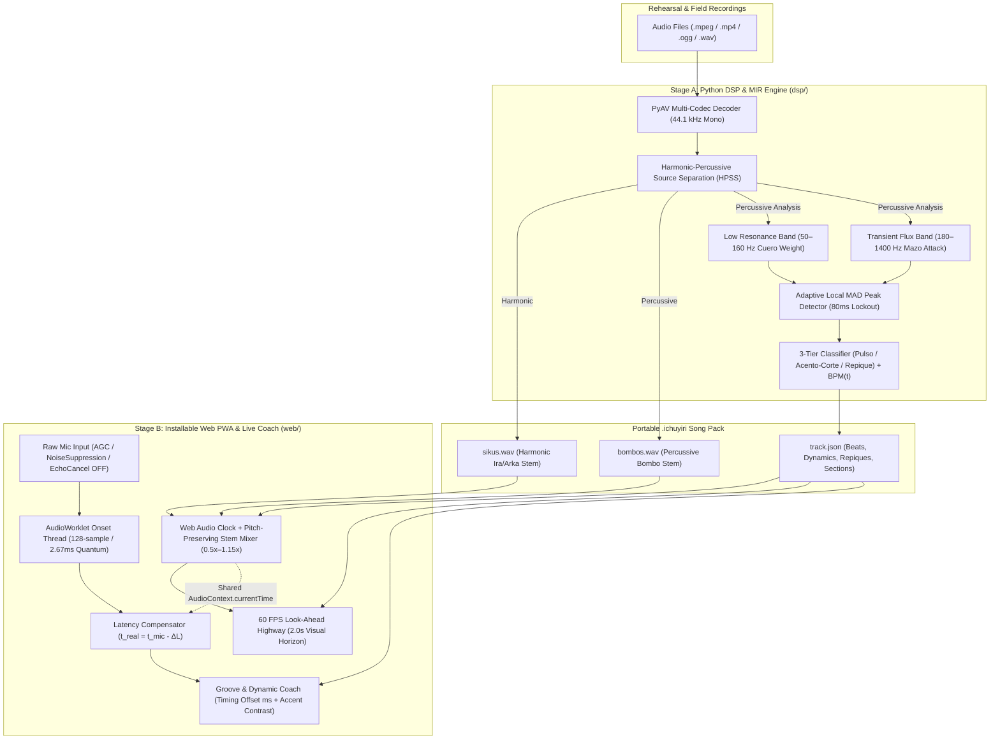
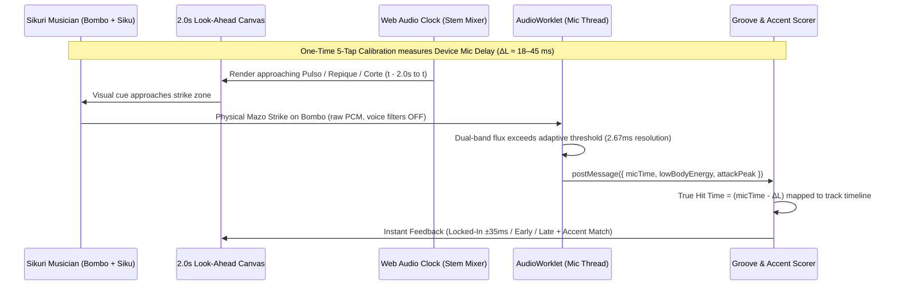

# Ichuyiri — System Architecture (`Sikuri de Varios Bombos`)

This document outlines the production architecture replacing the initial MATLAB scripts, designed specifically for **Sikuri de varios bombos** practice with **immediate real-time microphone listening**.

## 1. High-Level System Architecture

---

## 2. Live Microphone & Latency Compensation Sequence

Because a Sikuri percussionist strikes a **physical bombo or practice pad** (which produces instant acoustic sound in the room), Ichuyiri achieves **±5 ms rhythmic scoring precision** on standard laptops and phones without needing studio ASIO hardware:

